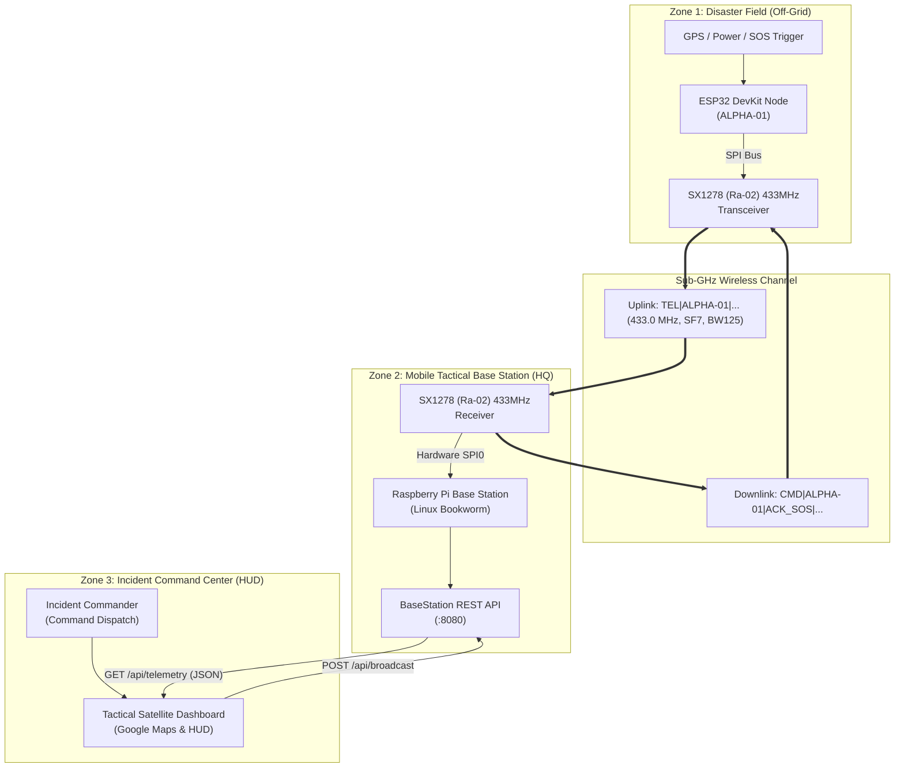

<div align="center">

# 🛰️ ResQnet / ResQ-Mesh
### Autonomous Long-Range LoRa Telemetry & Tactical Emergency Command Network

[](https://opensource.org/licenses/MIT)
[](https://www.espressif.com/)
[-orange.svg)](https://www.semtech.com/)
[](https://www.raspberrypi.com/)
[](#system-architecture)

*An infrastructure-independent, tactical emergency telemetry network built for disaster response, flood evacuation, and search-and-rescue (SAR) operations when cellular and internet infrastructure fail.*

</div>

---

## 📋 Table of Contents
1. [Abstract & Motivation](#-abstract--motivation)
2. [System Architecture](#-system-architecture)
3. [RF Link Specifications](#-rf-link-specifications)
4. [Hardware Specifications & Pinouts](#-hardware-specifications--pinouts)
5. [Packet Protocol Definition](#-packet-protocol-definition)
6. [Repository Structure](#-repository-structure)
7. [Getting Started & Installation](#-getting-started--installation)
   - [ESP32 Field Node Setup](#1-esp32-field-node-setup)
   - [Raspberry Pi Gateway Setup](#2-raspberry-pi-gateway-setup)
   - [Tactical Web Command Center](#3-tactical-web-command-center)
8. [End-to-End Verification & Testing](#-end-to-end-verification--testing)
9. [REST API Documentation](#-rest-api-documentation)
10. [Troubleshooting & Verification](#-troubleshooting--verification)
11. [Author & License](#-author--license)

---

## 🔬 Abstract & Motivation

During natural catastrophic events (flash floods, tsunamis, earthquakes, cyclones), terrestrial telecommunication backbones—cellular towers (LTE/5G), optical fiber backhauls, and commercial power grids—suffer severe outages or complete collapse. Under these conditions:
- Trapped civilians and frontline rescue operatives are unable to broadcast SOS coordinates.
- First responders operate blindly without localized situational awareness.
- Traditional consumer short-range protocols (Wi-Fi, Bluetooth Low Energy) fail due to multi-path attenuation in waterlogged terrains and severe range limitations (< 15 meters).

**ResQnet** solves this crisis by deploying a zero-dependency, off-grid **Sub-GHz LoRa (433.0 MHz Chirp Spread Spectrum)** telemetry network. Ruggedized field beacons acquire real-time tactical telemetry (GPS coordinates, battery levels, emergency states) and transmit them over kilometers directly to a centralized **Raspberry Pi Base Station Gateway**. The gateway decodes incoming packets, tracks signal metrics (RSSI, SNR), and serves a local real-time **Tactical Web Operations HUD** that allows disaster controllers to monitor field personnel and dispatch two-way relief drop commands.

---

## 🏛️ System Architecture



---

## 📡 RF Link Specifications

ResQnet employs Chirp Spread Spectrum (CSS) modulation on the 433 MHz ISM band for optimal obstacle penetration and link budget in adverse weather:

| Parameter | Operational Setting | Technical Rationale |
| :--- | :--- | :--- |
| **Carrier Frequency** | `433.0 MHz` | Deep foliage & concrete obstacle penetration in disaster zones |
| **Modulation** | Chirp Spread Spectrum (CSS) | Resilient to in-band interference and multipath Doppler shifts |
| **Spreading Factor (SF)** | `SF7` (128 chips/symbol) | High on-air bit rate with low latency (~45ms packet duration) |
| **Signal Bandwidth (BW)** | `125.0 kHz` | Standard LoRa channel balance between sensitivity and speed |
| **Coding Rate (CR)** | `4/5` | Forward Error Correction (FEC) detecting bit flips over long range |
| **Sync Word** | `0x12` | Network layer isolation from public LoRaWAN gateways |
| **Preamble Length** | `8 symbols` | Receiver synchronisation sequence |
| **Transmit Power** | `+14 dBm` (~25 mW) | Optimal signal integrity without saturating close-range base stations |
| **Hardware CRC** | `Enabled (16-bit)` | Automatic cyclic redundancy rejection of corrupt/noisy packets |

---

## 🔌 Hardware Specifications & Pinouts

### 1. ESP32 Field Node Wiring (SPI Interface)

Connect the **Ra-02 SX1278** module to the **ESP32 DevKit (30-pin)** using the following pin mapping:

| Ra-02 Pin | ESP32 GPIO | Physical Wire Color | Description |
| :--- | :--- | :--- | :--- |
| **3.3V (VCC)** | `3V3` | 🔴 Red | Regulated 3.3V DC Power (*Never connect to 5V!*) |
| **GND** | `GND` | ⚫ Black | System Common Ground |
| **NSS / SS** | `GPIO 5` | 🟠 Orange | SPI Chip Select (Active Low) |
| **RST** | `GPIO 14` | ⚪ White | Hardware Reset |
| **DIO0** | `GPIO 2` | 🟣 Purple | Interrupt / Packet Rx-Tx Done |
| **MOSI** | `GPIO 23` | 🔵 Blue | SPI Master Out Slave In |
| **MISO** | `GPIO 19` | 🟢 Green | SPI Master In Slave Out |
| **SCK** | `GPIO 18` | 🟡 Yellow | SPI Clock |

> [!WARNING]
> Semtech SX1278 chips operate strictly on **3.3V logic and power**. Connecting the Ra-02 module to the ESP32's `VIN` or `5V` pin will destroy the RF transceiver permanently.

---

### 2. Raspberry Pi Base Station Gateway Wiring

Connect the Base Station **Ra-02 SX1278** to the **Raspberry Pi 40-Pin Header**:

| Ra-02 Pin | Raspberry Pi Pin | Function | Broadcom BCM GPIO |
| :--- | :--- | :--- | :--- |
| **3.3V (VCC)** | `Pin 1` | 3.3V DC Power | 3V3 Power |
| **GND** | `Pin 6` or `Pin 9` | Ground | Ground |
| **MISO** | `Pin 21` | SPI0 MISO | `GPIO 9` |
| **MOSI** | `Pin 19` | SPI0 MOSI | `GPIO 10` |
| **SCK** | `Pin 23` | SPI0 SCLK | `GPIO 11` |
| **NSS / CS** | `Pin 24` | SPI0 CE0 | `GPIO 8` |
| **RST** | `Pin 22` | GPIO Output | `GPIO 25` |
| **DIO0** | `Pin 18` | GPIO Input | `GPIO 24` |

---

## 📦 Packet Protocol Definition

ResQnet implements a lightweight, delimiter-based tactical protocol designed for minimal airtime and high parse reliability:

### 1. Uplink Telemetry Packet (`TEL`)
Transmitted periodically (every 3 seconds) or immediately upon distress interrupt from field nodes:

```text
TEL|<NODE_ID>|<LATITUDE>,<LONGITUDE>|<BATTERY>%|<STATUS>|SEQ:<COUNTER>
```

**Example Uplink:**
```text
TEL|ALPHA-01|26.2006,92.9376|98%|NORMAL|SEQ:142
TEL|ALPHA-01|26.2006,92.9376|98%|SOS_CRITICAL|SEQ:143
```

*Fields:*
- `TEL`: Packet Type identifier (Telemetry Uplink).
- `ALPHA-01`: Unique alphanumeric identifier of the field agent or beacon.
- `26.2006,92.9376`: WGS-84 Decimal GPS latitude and longitude.
- `98%`: Remaining battery capacity.
- `STATUS`: State machine flag (`NORMAL` or `SOS_CRITICAL`).
- `SEQ:142`: 16-bit incrementing sequence number for packet loss and delivery verification.

---

### 2. Downlink Tactical Command Packet (`CMD`)
Transmitted from the Base Station Gateway back to field units for command execution and distress acknowledgement:

```text
CMD|<TARGET_NODE>|<ACTION>|<PAYLOAD>
```

**Example Downlink:**
```text
CMD|ALPHA-01|ACK_SOS|STANDBY
CMD|ALPHA-01|ACK_SOS|MEDICAL_DROP_AT_26.2006,92.9376
```

When received by the ESP32 node, it triggers a local buzzer/serial notification and automatically resets the `SOS_CRITICAL` distress beacon back to `NORMAL` state.

---

## 📂 Repository Structure

```text
ResQnet/
├── .gitignore
├── LICENSE
├── README.md
│
├── esp32_field_node/               # ESP32 LoRa Firmware (PlatformIO)
│   ├── platformio.ini              # Toolchain & library dependencies
│   ├── src/
│   │   └── main.cpp                # Core firmware (LoRa TX/RX, Telemetry, Serial trigger)
│   ├── include/
│   └── lib/
│
├── raspberry_pi_gateway/           # Raspberry Pi Base Station Service
│   ├── base_station.py             # Hardware SPI RX, RSSI/SNR compute & REST API
│   ├── requirements.txt            # Python dependencies
│   └── setup_gateway.sh            # Automated Bookworm SPI & environment setup script
│
└── dashboard/                      # Tactical Satellite Command Center
    └── index.html                  # Glassmorphism dark-theme HUD & Google Maps visualizer
```

---

## 🚀 Getting Started & Installation

### 1. ESP32 Field Node Setup

1. **Install PlatformIO:**
   Install Visual Studio Code and add the **PlatformIO IDE** extension.
2. **Open Project:**
   Open the `esp32_field_node` folder in VS Code.
3. **Configure COM Port:**
   Check your operating system's device manager for your ESP32 serial port (e.g., `COM14` on Windows or `/dev/ttyUSB0` on Linux) and verify `platformio.ini`:
   ```ini
   [env:esp32dev]
   platform = espressif32@6.4.0
   board = esp32dev
   framework = arduino
   monitor_speed = 115200
   upload_port = COM14
   monitor_port = COM14
   lib_deps =
       sandeepmistry/LoRa@^0.8.0
   ```
4. **Compile & Upload:**
   Click the PlatformIO **Upload** arrow or run in terminal:
   ```bash
   cd esp32_field_node
   pio run --target upload
   ```
5. **Monitor Telemetry:**
   Open serial monitor at `115200` baud:
   ```text
   ========================================
     ResQ-Mesh Tactical Field Node (ALPHA-01)
   ========================================
   ✅ LoRa Ready at 433.0 MHz.
   📡 [LORA TX] Broadcasting: TEL|ALPHA-01|26.2006,92.9376|98%|NORMAL|SEQ:1
   ```

---

### 2. Raspberry Pi Gateway Setup

1. **Clone or Copy to Raspberry Pi:**
   ```bash
   git clone https://github.com/Sharukhh69/ResQnet.git
   cd ResQnet/raspberry_pi_gateway
   ```
2. **Run the Automated Setup Script:**
   ```bash
   chmod +x setup_gateway.sh
   ./setup_gateway.sh
   ```
3. **Launch the Base Station:**
   ```bash
   sudo python3 base_station.py
   ```
4. **Expected Output:**
   ```text
   ============================================================
     ResQ-Mesh Tactical Base Station & Web Server Online
     433.0 MHz LoRa + Live Telemetry REST API (:8080)
   ============================================================
   🌐 Base Station Web API live at http://0.0.0.0:8080/api/telemetry

   🎯 [PACKET #1] ALPHA-01 | Status: NORMAL | Batt: 98% | RSSI: -86dBm | SNR: -2.8dB
   🎯 [PACKET #2] ALPHA-01 | Status: NORMAL | Batt: 98% | RSSI: -85dBm | SNR: 3.1dB
   ```

---

### 3. Tactical Web Command Center

1. Open `dashboard/index.html` directly in any modern web browser (Google Chrome, Edge, Safari).
2. Click **"INITIALIZE UPLINK"** in the top control panel.
3. The dashboard connects to the Raspberry Pi Base Station REST stream at `http://<RPI_IP>:8080`.
4. The system status transitions to `🟢 LORA NETWORK ACTIVE`.
5. Field Unit `ALPHA-01` renders immediately on the satellite map with a live pulsing radar circle, signal strength indicator, and live telemetry card.

---

## 🧪 End-to-End Verification & Testing

### Live SOS Distress Trigger Test
To simulate a stranded civilian or emergency operative triggering an SOS distress call in the field:

1. **Trigger Distress on Node:**
   Send `SOS` to the ESP32 serial interface at `115200` baud (or via external pushbutton):
   ```python
   # Windows PowerShell / Python one-liner:
   python -c "import serial; s=serial.Serial('COM14', 115200); s.write(b'SOS\n'); s.close(); print('Distress Triggered')"
   ```
2. **Field Node Response:**
   ```text
   🚨 [EMERGENCY TOGGLED] Mode: CRITICAL SOS!
   📡 [LORA TX] Broadcasting: TEL|ALPHA-01|26.2006,92.9376|98%|SOS_CRITICAL|SEQ:14
   ```
3. **Gateway Output:**
   ```text
   🎯 [PACKET #14] ALPHA-01 | Status: SOS_CRITICAL | Batt: 98% | RSSI: -84dBm | SNR: 4.2dB
   ```
4. **Dashboard Response:**
   - Field unit card border flashes **neon red (`#ff2a55`)**.
   - Live badge switches to `🚨 SOS CRITICAL`.
   - Radar ping pulses red across Google Maps.

### Tactical Downlink Command Test
1. On the web dashboard, click anywhere on the tactical map to target a drop zone.
2. Select resource type (e.g., `FOOD / MEDICAL SUPPLY`).
3. Click **"EXECUTE BROADCAST"**.
4. The Base Station immediately shifts from `RXCONT` to `TX`, encodes the command, and broadcasts over LoRa:
   ```text
   📡 [HQ DOWNLINK TX] Transmitting over LoRa: CMD|ALPHA-01|ACK_SOS|FOOD / MEDICAL SUPPLY_AT_26.2006,92.9376
   ✅ Command Broadcast Complete. Returned to RXCONT.
   ```
5. The ESP32 receives the RF frame, logs:
   ```text
   🎯 >>> [HQ DOWNLINK COMMAND RECEIVED] <<<
   Payload : CMD|ALPHA-01|ACK_SOS|FOOD / MEDICAL SUPPLY_AT_26.2006,92.9376
   Signal  : -82 dBm
   ✅ HQ Acknowledged Emergency. Reset to NORMAL.
   ```
6. The emergency mode resets automatically!

---

## 🌐 REST API Documentation

The Raspberry Pi Base Station exposes a high-performance HTTP REST interface with CORS enabled:

### 1. `GET /api/telemetry`
Returns the latest decoded telemetry packet and RF signal quality metrics.

**Response (`200 OK`):**
```json
{
  "node_id": "ALPHA-01",
  "lat": 26.2006,
  "lon": 92.9376,
  "battery": "98%",
  "status": "NORMAL",
  "seq": "SEQ:142",
  "rssi": -85,
  "snr": 3.2,
  "last_seen": "22:45:10"
}
```

---

### 2. `POST /api/broadcast`
Transmits a tactical command frame over 433 MHz LoRa to field units.

**Request Body (`application/json`):**
```json
{
  "command": "CMD|ALPHA-01|ACK_SOS|STANDBY"
}
```

**Response (`200 OK`):**
```json
{
  "status": "broadcast_sent"
}
```

---

## 🛠️ Troubleshooting & Verification

| Issue | Root Cause | Solution |
| :--- | :--- | :--- |
| `ERROR: LoRa init failed!` on ESP32 | Wiring error on SPI pins (SS/RST/DIO0) or loose 3.3V jumper | Verify jumper seated firmly. Ensure `LORA_SS=5`, `LORA_RST=14`, `LORA_DIO0=2`. |
| Garbage characters in Pi terminal (`TE\|APK1\|...`) | Receiver saturated by high transmit power or disabled CRC | Ensure ESP32 has `LoRa.enableCrc()` and `LoRa.setTxPower(14)` enabled. |
| Pi throws `FileNotFoundError: /dev/spidev0.0` | SPI interface disabled in Raspberry Pi Linux kernel | Run `sudo raspi-config nonint do_spi 0` and reboot Pi. |
| Dashboard shows `Waiting for Base Station stream...` | Laptop cannot reach Pi IP or port 8080 is blocked | Confirm Pi is on same Wi-Fi (`ping 192.168.29.99`) and `base_station.py` is running. |

---

## 👤 Author & Academic Attribution

- **Lead Engineer:** Sharukhesh S ([@Sharukhh69](https://github.com/Sharukhh69))
- **Institution:** Sri Eshwar College of Engineering (SECE)
- **Project Domain:** Tactical Disaster Telecommunications / Wireless Sensor Networks (WSN)

---

## 📄 License

This project is licensed under the **MIT License** — see the [LICENSE](LICENSE) file for full details.
